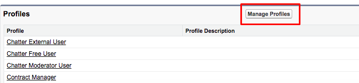

# [!DNL Marketo Measure] Insights 設定 {#marketo-measure-insights-configuration}

[!DNL Marketo Measure] Insights Canvas アプリはリードページレイアウトに追加する必要がありますが、[!DNL Salesforce]設定の「Connected Apps」セクションで追加の設定が必要です。 Canvas アプリに適切な権限があることを確認するには、次の手順に従います。

1. [!DNL Salesforce] セットアップに移動し、「[!UICONTROL &#x200B; アプリを管理]」タブの「**[!UICONTROL 接続アプリ]**」をクリックします。

1. 入力するリストから[!DNL Marketo Measure Insights]を選択します。

1. 「[!UICONTROL OAuth] ポリシー」セクションで、「許可されたユーザー」設定を「管理者承認済みユーザーが事前許可されています」に変更します。 ポップアップが表示され、**[!UICONTROL OK]**&#x200B;をクリックしてから&#x200B;**[!UICONTROL 保存]**&#x200B;をクリックします。

   

1. ページが保存されたら、「**[!UICONTROL プロファイルを管理]**」ボタンをクリックできます。

   

1. [!DNL Marketo Measure] インサイトへのアクセス権を持つすべてのプロファイルを選択し、**[!UICONTROL 保存]**&#x200B;をクリックします。
