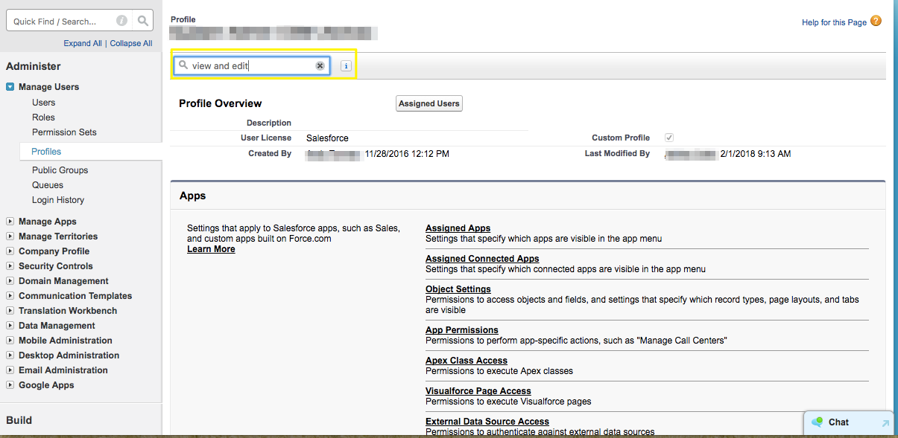
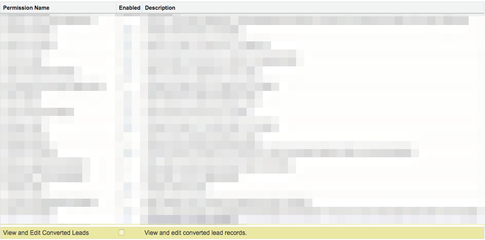

# コンバージョン済みリードの編集権限の有効化 {#enabling-the-permission-to-edit-converted-leads}

[!DNL Salesforce]で変換済みリード レコードを編集する権限を有効にする方法を説明します。 [!DNL Marketo Measure]には、Salesforceの様々なオブジェクトにデータをプッシュする機能があります。 リードにプッシュする場合、一部のシナリオでは、既にコンバージョン済みのリードレコードに再プッシュする必要がある場合があります。 これらのレコードにデータをプッシュするには、接続されているユーザーが、プロファイルレベルでコンバージョン済みリードを表示および編集する権限を持っている必要があります。

1. [!UICONTROL  セットアップ ]に移動し、[!UICONTROL  ユーザーの管理] グループを展開してプロファイルを選択します。

   

1. 接続しているユーザーのプロファイルを選択します。

1. 変換済みリードを表示および編集する権限を検索します。

   

1. 変換済みリードの表示と編集を有効にするには、このチェックボックスをオンにします。

   

これで完了です。
