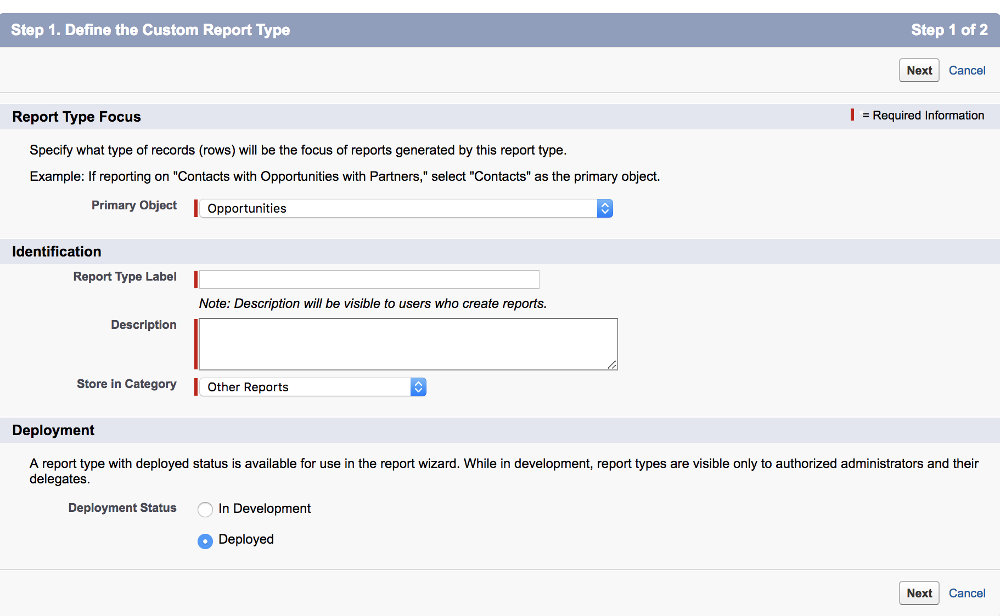
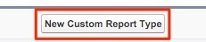
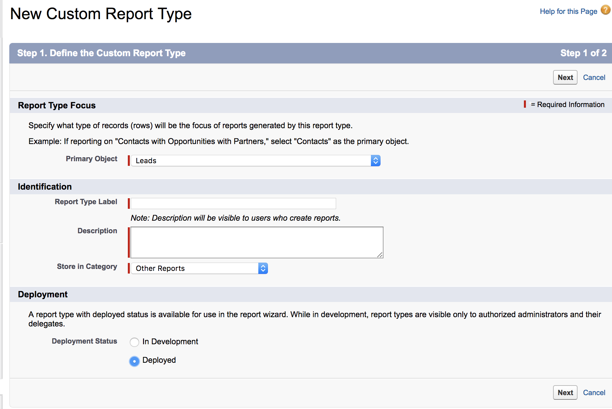
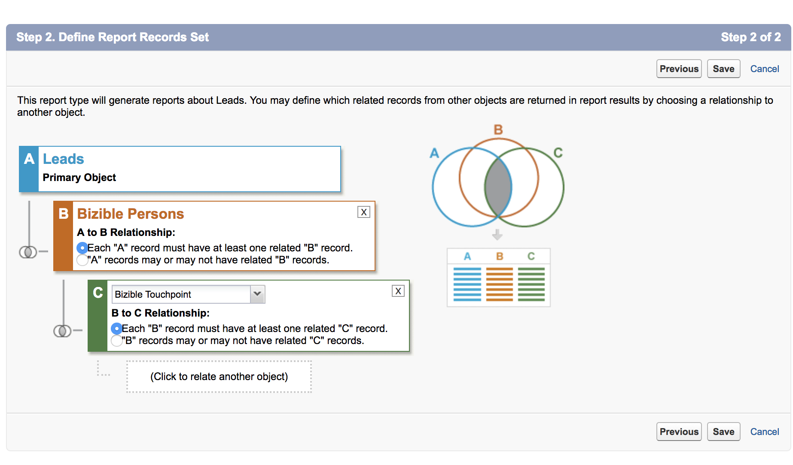

# 商談を含まない取引先責任者用レポートタイプ {#report-type-for-contacts-without-opportunities}

>[!NOTE]
>
>ドキュメントに「[!DNL Marketo Measure]」を指定する手順が表示される場合がありますが、CRMには「[!DNL Bizible]」が表示されます。 アドビは現在更新に取り組んでおり、ブランディングの変更はまもなく CRM に反映される予定です。

商談に関連付けられていないバイヤータッチポイントを持つ連絡先をレポートするには、カスタムレポートタイプを作成する必要があります。

1. **[!UICONTROL 設定]** > **[!UICONTROL 作成]** > **[!UICONTROL レポートタイプ]**&#x200B;に移動します。

   

1. **[!UICONTROL 新しいカスタムレポートタイプ]**&#x200B;を選択します。

   

1. [!UICONTROL プライマリオブジェクト &#x200B;]を「[!UICONTROL 連絡先]」に設定します。 レポートタイプラベルに「バイヤーのタッチポイントを使用した連絡先」という名前を付けます。 レポートタイプ名には、同じ名前を使用します。 説明入力内の「購入者のタッチポイントへの連絡」をクリックします。 「[!UICONTROL その他]」内にレポートを保存し、レポートを「[!UICONTROL &#x200B; デプロイ &#x200B;]」に設定します。

   

1. そこから、Contacts オブジェクトをBuyer Touchpoints オブジェクトにリンクします。 「各「A」レコードには、関連する「B」レコードが少なくとも1つ必要です」ボタンを選択していることを確認します。

   にリンクします

1. **[!UICONTROL 保存]**&#x200B;をクリックすると、完了です。
