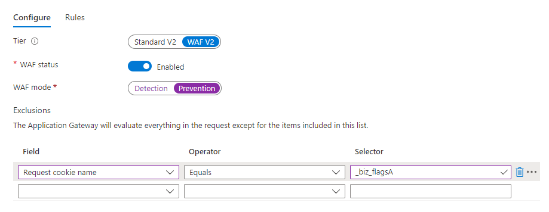

# Marketo Measure の Cookie {#marketo-measure-cookies}

[!DNL Marketo Measure] の JavaScript をランディングページに適用する際に、サイトに読み込まれる様々な [!DNL Marketo Measure] の Cookie について説明します。 この情報は、実装時に web 開発チームに役立つ場合があります。

>[!IMPORTANT]
>
>プライバシーに関する懸念により、サードパーティ Cookie は廃止されます。 Google Chrome が 2024 年第 3 四半期に発表したサードパーティ Cookie の廃止は、事実上、この形式のトラッキングの終了を意味します。 その結果、アドビでは、サードパーティ Cookie に依存する Marketo Measure 機能、特に、Google／DoubleClick インプレッション Cookie を使用するクロスドメイントラッキングとビュースルーアトリビューションを廃止します。 Marketo Measure のその他の機能に影響はありません。 また、ファーストパーティ cookie の使用にも影響はありません。 Google のスケジュールを考慮すると、上記 2 つの機能の廃止予定日は 2024年6月1日（PT）です。 この日付より前に収集された関連データは、アドビのお客様が引き続き使用できます。

| cookie 名 | cookie タイプ | 目的 | 有効期限 | Secure フラグが設定されていますか？ | HTTPOnly フラグが設定されていますか？ | cookie セッター |
| --- | --- | --- | --- | --- | --- | --- |
| `_biz_uid` | ファーストパーティ | 現在のドメインでユーザーを一意に識別します。 | 1 年 | いいえ | いいえ | `bizible.js` |
| `_biz_nA` | ファーストパーティ | 内部診断目的で、Marketo Measure がすべてのリクエストに含めるシーケンス番号です。 | 1 年 | いいえ | いいえ | `bizible.js` |
| `_biz_flagsA` | ファーストパーティ | フォーム送信、クロスドメイン移行、ビュースルーピクセル、トラッキングのオプトアウトステータスなど、様々なユーザー情報を保存する cookie です。 | 1 年 | いいえ | いいえ | `bizible.js` |
| `_biz_pendingA` | ファーストパーティ | Marketo Measure サーバーに正常に送信されるまで、分析データを一時的に保存します。 | 1 年 | いいえ | いいえ | `bizible.js` |
| `_biz_ABTestA` | ファーストパーティ | OptimizerおよびVisual Web Optimizer ABTests データから取得したチェックサムのリストが既に報告されているため、`bizible.js`が収集したデータを再送信できません。 | 1 年 | いいえ | いいえ | `bizible.js` |
| `_biz_EventA` | ファーストパーティ | `bizible.js`が収集したデータを再送信できないように、Bizible Eventsによって報告されたチェックサムのリスト。 | 1 年 | いいえ | いいえ | `bizible.js` |
| `_biz_su` | ファーストパーティ | 複数のドメイン間でユーザーを識別するユニバーサルユーザー ID です。ITP 制限をバイパスする統合を使用しているテナントにのみ適用されます。 | 1 年 | はい | いいえ | Edgecast |
| `_BUID` | サードパーティ，domain=.bizible.com | 複数のドメイン間でユーザを識別するユニバーサルユーザ ID です。 | 1 年 | はい | いいえ | Edgecast |
| `_BUID` | サードパーティ，domain=.bizibly.com | テナントのドメインの Marketo Measure cookie ID とその Doubleclick インプレッション cookie ID 間のマッピングです。 | 1 年 | はい | いいえ | Edgecast |

JavaScript の設定中に Web Application Firewall（WAF）の警告がトリガーされた場合、ユーザは、次の例に示すように、その WAF ルールを無効にするか、Cookie を許可リストに登録することができます。

