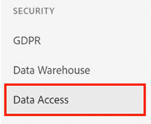

# [!UICONTROL Discover Data Download] アクセス制御 {#discover-data-download-access-control}

[!UICONTROL  データの検出ダウンロード ]制御により、[!DNL Marketo Measure]管理者は、ユーザーの役割に基づいて、検出ダッシュボードのデータのダウンロードポリシーを設定できます。 コントロールには、「もっと知る」ダッシュボードのすべてのデータダウンロードアクションが含まれます。

1. 「[!UICONTROL  セキュリティ ]」の下の「**[!UICONTROL データアクセス]**」をクリックします。

   

1. ドロップダウンをクリックし、コンソールに適したオプションを選択します。

   

   <table>
    <tr>
     <td><strong>すべてのユーザー</strong></td>
     <td>PDFとCSVの両方を含むデータをダウンロードできます。</td>
    </tr>
    <tr>
     <td><strong>管理者ユーザーのみ</strong></td>
     <td>PDFとCSVの両方を含むデータをダウンロードできるのは、管理者ユーザーのみです。</td>
    </tr>
    <tr>
     <td><strong>None</strong></td>
     <td>PDFとCSVの両方を含むデータをダウンロードすることはできません。</td>
    </tr>
   </table>

1. 終了したら「**[!UICONTROL 保存]**」をクリックします。

   

>[!NOTE]
>
>この設定は、ユーザーがログアウトして再度ログインするまで有効にならない場合があります。
